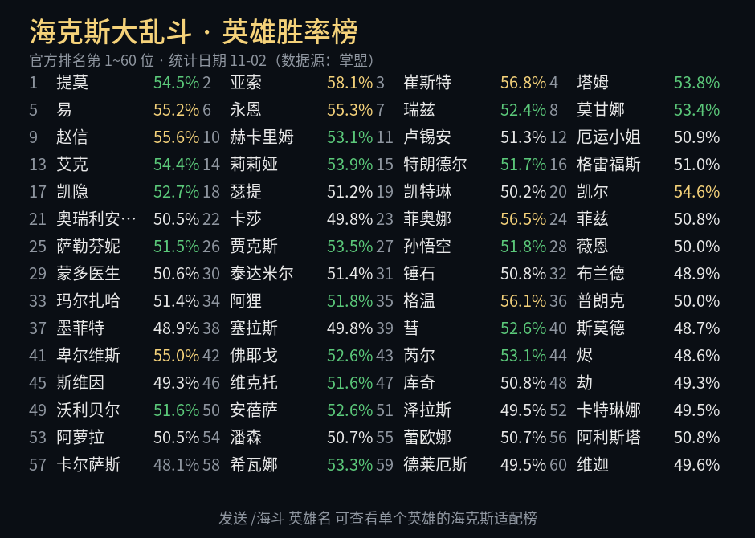
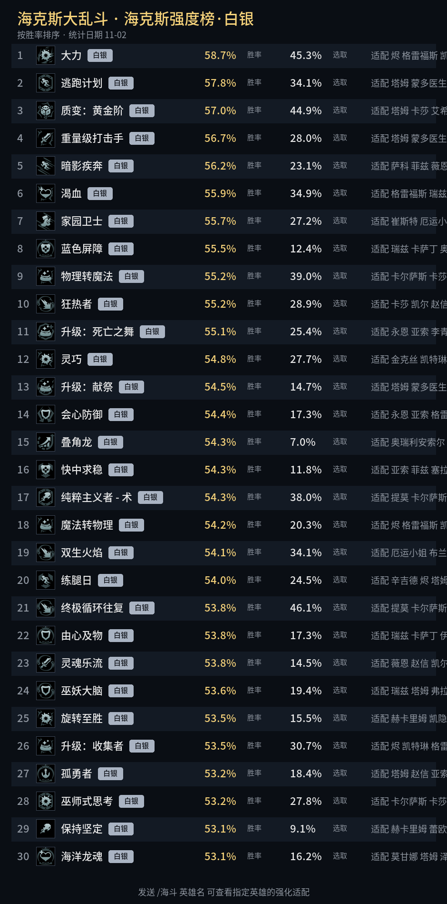
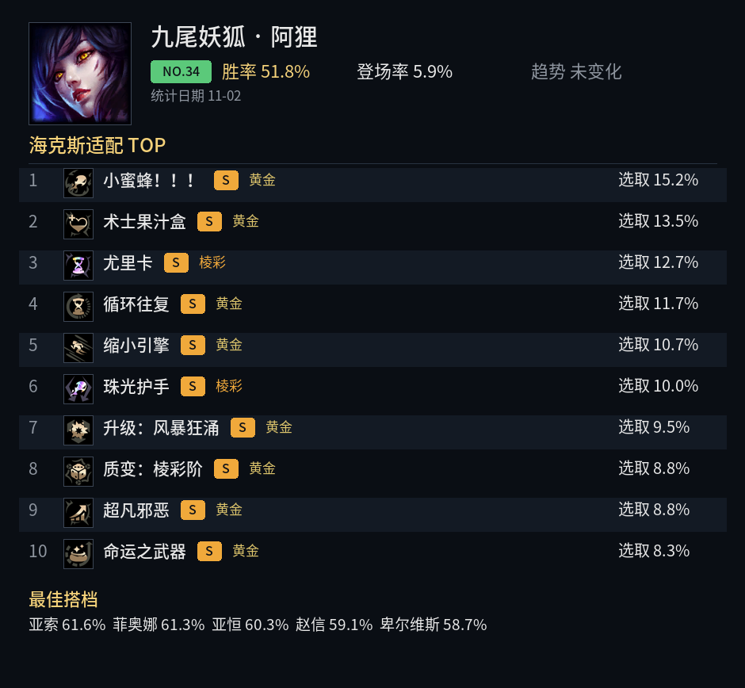
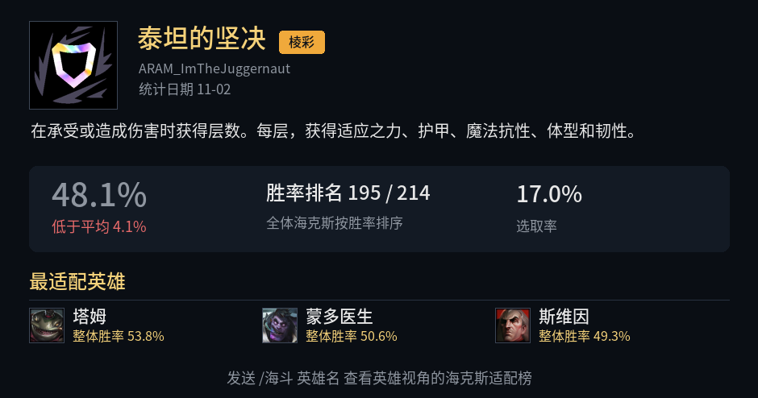

# astrbot_plugin_haidou

英雄联盟「海克斯大乱斗」（海斗）数据查询插件，数据源为掌盟官方接口，国内直连、无需任何密钥、不消耗 LLM token。

## 功能

| 指令 | 效果 |
|---|---|
| `/海斗` | 英雄胜率榜（官方排名，胜率彩色分级） |
| `/海斗 阿狸` | 单英雄：排名 / 胜率 / 登场率 / 趋势 + 海克斯适配 TOP10（含 S/A 评级）+ 最佳搭档 |
| `/海斗 ali` | 支持拼音、关键词、称号模糊匹配 |
| `/海斗海克斯` | 海克斯强度榜（按胜率排序，含图标与最适配英雄） |
| `/海斗海克斯 棱彩` | 按等级筛选（棱彩 / 黄金 / 白银） |
| `/海斗海克斯 泰坦` | 单海克斯详情：总体胜率、与平均差值、胜率排名、效果描述、最适配英雄 |

## 示例

| 胜率榜 | 海克斯榜 | 英雄卡 | 海克斯详情 |
|---|---|---|---|
|  |  |  |  |

## 特性

- 榜单数据缓存 2 小时、图标永久缓存，避免重复请求
- 统计日期自动回退：当天未出榜时自动查询前几日数据
- 所有榜单渲染为图片卡片，QQ 内直接展示
- 展示数量可在 WebUI 插件配置中调整

## 安装

从 AstrBot WebUI「插件市场」搜索 `haidou` 安装，或手动克隆本仓库至 `data/plugins/`：

```bash
git clone https://github.com/2417841402/astrbot_plugin_haidou
```

## 数据来源

- 掌盟（mlol.qt.qq.com）海斗统计接口
- 英雄与海克斯静态资源（game.gtimg.cn）

本插件仅作数据展示，与腾讯 / Riot 无关。
